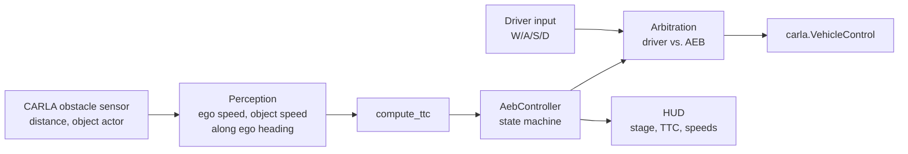

# Forward Collision Warning & Automatic Emergency Braking (CARLA)

[](https://github.com/IngQadir/carla-autobrake/actions/workflows/tests.yml)


A **Forward Collision Warning (FCW)** and **Automatic Emergency Braking (AEB)** function based on
**Time-to-Collision (TTC)** with staged thresholds, running in the [CARLA](https://carla.org) driving simulator.
You drive the car manually; the system warns you and brakes on its own if a collision becomes imminent.

<!-- DEMO: drag your demo video or GIF into this line in the GitHub editor -->

---

## How it works

**Time-to-Collision** is the time left until impact if nothing changes:

```
TTC = distance / closing speed        closing speed = v_ego - v_object
```

If the gap is not shrinking (same speed, object faster, or the car is standing still), TTC is infinite and the
system stays passive.

| Stage | Condition | Action |
|---|---|---|
| `NORMAL` | TTC ≥ 2.6 s | none |
| `FCW` | TTC < 2.6 s | flashing collision warning on the HUD |
| `PARTIAL_BRAKE` | TTC < 1.6 s | 40 % brake, throttle cut |
| `FULL_BRAKE` | TTC < 0.8 s | 100 % brake, held until standstill |

Design rules of the state machine:

- **Escalate immediately** – the system jumps straight to the stage the current TTC requires
  (also directly to `FULL_BRAKE` if an obstacle appears late).
- **De-escalate with hysteresis** – a stage is left only when TTC is 0.3 s above its threshold, so the warning
  does not flicker.
- **Hold full braking until standstill**, as in production AEB systems.
- **Driver can always brake harder**, never weaker: `brake = max(driver, AEB)`.

## Architecture



The decision logic (`aeb_logic.py`) is **pure Python with no CARLA dependency**. This keeps the safety-relevant
part small and fully unit-testable, and the simulator script only does sensing, arbitration and display.

## Project structure

```
aeb_logic.py                  TTC calculation + FCW/AEB state machine (no CARLA dependency)
manual_control_autobrake.py   CARLA client: sensors, driver input, arbitration, HUD
tests/test_aeb_logic.py       pytest unit tests (17 tests, 100 % coverage of aeb_logic.py)
.github/workflows/tests.yml   CI: runs the tests on Python 3.10 / 3.11 / 3.12 on every push
```

## Running it

Requirements: CARLA **0.9.14** (Windows or Linux) and the Python version matching your CARLA build
(3.7 for the prebuilt 0.9.14 package).

```bash
# 1. Install the CARLA client and pygame
py -3.7 -m pip install <CARLA>/PythonAPI/carla/dist/carla-0.9.14-cp37-cp37m-win_amd64.whl pygame

# 2. Start the simulator
<CARLA>/CarlaUE4.exe

# 3. Copy aeb_logic.py and manual_control_autobrake.py into <CARLA>/PythonAPI/examples and run
py -3.7 manual_control_autobrake.py
```

| Key | Function |
|---|---|
| `W` | throttle |
| `S` | brake (reverse when stopped) |
| `A` / `D` | steer |
| `SPACE` | handbrake |
| `ESC` / `Q` | quit |

Set `DEBUG = True` in `manual_control_autobrake.py` to print every detected object (type, distance, TTC)
to the console.

## Testing

```bash
pip install pytest pytest-cov
python -m pytest -v --cov=aeb_logic --cov-report=term-missing
```

The tests cover the TTC formula (static and moving objects, not closing, no object), every stage, direct
escalation to full braking, hysteresis, brake hold until standstill, custom thresholds, and a regression test
for a bug found in simulation (see below).

## Lessons learned

During the first simulation runs the car locked into `FULL_BRAKE` while standing still. The debug output showed
the obstacle sensor reporting an object at **0.0 m**: it was mounted inside the vehicle's bounding box, and the
logic returned TTC = 0 for zero distance even without any closing speed.
Fixes: sensor moved in front of the bumper and raised, implausible readings and self-hits filtered, and TTC
now checks the closing speed first. A regression test makes sure the bug cannot come back.

## Possible extensions

- Speed-dependent thresholds and brake-jerk limiting
- Radar sensor (`sensor.other.radar`) for direct relative-velocity measurement
- Scenario-based testing with CARLA ScenarioRunner (Euro NCAP CCRs / CCRm car-to-car scenarios)
- Port of the state machine to Embedded C for an ECU target
